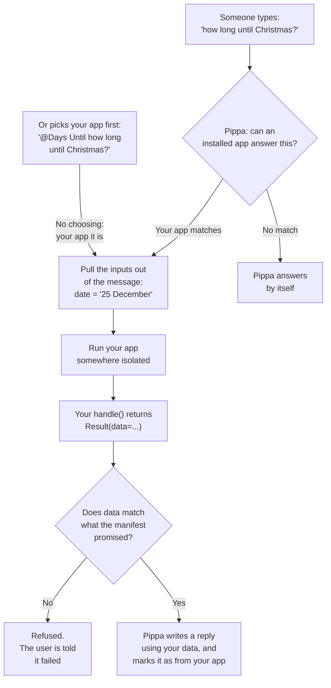

# What actually happens when someone asks Pippa something

Useful to understand, because almost every confusing problem you will hit
comes from one of these steps — usually step 2.

## The journey of one question

### Step by step

1. **Someone asks a question.** Pippa compares it against every outcome of
   every app that user has installed, using each outcome's `summary` and
   `example_phrases`. This is the routing step, and it is where most apps
   quietly fail — see `README.md`. If the person picked an app with `@`,
   this step is skipped; see below.

2. **The inputs are extracted.** A model reads the message and fills in the
   inputs your manifest declares, guided by each input's `description`. Write
   those descriptions as instructions to whoever is filling the field in, and
   always say what to do when the message does not contain it — otherwise it
   will guess.

3. **Your app runs.** A fresh copy of your `App` class is constructed, your
   `handle(call)` is called once, and the whole thing is discarded afterwards.
   It runs in a sandbox with a 20-second limit, with no access to Pippa, to
   any user's data, or to any other app. It can reach the public internet and
   nothing else.

4. **Your result is checked against your manifest.** Every field in `output`
   must be present and the right type, and anything you did not declare is
   rejected. This is not a lint step you can skip — a mismatch fails the call.

5. **Pippa writes the reply.** It uses your `data`, and your `narrative` if
   you gave one, and shows the user a badge saying the answer came from your
   app, and whether they picked it or Pippa did. Your app's name is visible
   to the user, so give it a good one.

### When the person picks your app with `@`

Starting a message with `@` and picking an app from the list (or typing its
full name) sends that message to that app and no other. Step 1 is skipped:
nothing decides whether the words suit your app. Steps 2 to 5 happen as
usual — Pippa still pulls the inputs out of the message, and if your app has
several outcomes, a model still picks which of *yours* fits. Two things
differ:

- Your app is told so: `call.context.explicit` is `True`, provided the app
  was published after the platform update that added it. One published
  before that sees it only after you publish it again; see below the table.
- If your app cannot answer, Pippa says so in one sentence — *"Days Until
  couldn't answer: I could not work out which date you meant."* — instead of
  answering from her own knowledge, and she never hands the question to
  another app.

That makes `@` the honest test of your app, and no test at all of routing.

## What your app is given, and what it is not

| Given | Not given |
|---|---|
| `call.inputs` — the extracted inputs, and only the ones you declared | Who the user is |
| `call.context.now` — the current time | Their email, name or account |
| `call.context.request_id` — an id for your logs | The conversation, or any earlier message |
| `call.context.explicit` — whether the person picked your app by name | Any other app, or anything Pippa knows |

This is the reason a stranger's app can be allowed to run at all. It is not a
promise your app makes; it is the shape of what it is handed.

`explicit` says how the call came about, not who made it. Read it as
`getattr(call.context, "explicit", False)`: it only reaches an app published
after the platform update that added it, because the SDK your app runs on is
fixed when it is published. An app published before that update is still
called when somebody picks it with `@`, but it runs on an older SDK that has
no such field, and it sees the flag only after you publish it again.

## Why `persistence: none` is not negotiable

Your app does not have a disk it can rely on, or memory between calls.
Anything you write may be gone on the next request, or may be on a different
machine entirely. An app that appears to remember things in testing and then
forgets them in production is the classic version of this bug.

If your app needs something to persist, it is the wrong shape for this
platform. Build something that answers a question from its inputs plus the
live world.

## Why the manifest is checked so strictly

The manifest is what a user is shown before they install your app. If an app
could return fields it had not declared, or do things it had not listed, then
that screen would be a guess rather than a promise.

So the rule is: **the manifest is the contract, and the platform enforces it
in both directions.** You cannot be asked to do something you did not declare,
and you cannot return something you did not declare.

In practice this means: write the manifest first. It is the design.

## A note on time

Use `call.context.now`, never `datetime.now()`.

Two reasons. Your tests can fix the time, so a test that passes today still
passes next March. And when a user tells you their time zone, you can work out
what "today" means *for them* — which is different from the server's today for
a good part of every day. The example app has a test for exactly this.
