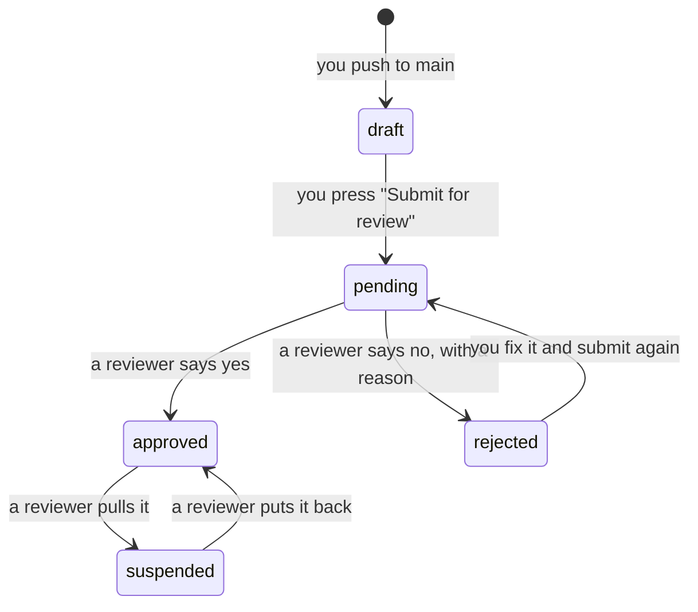
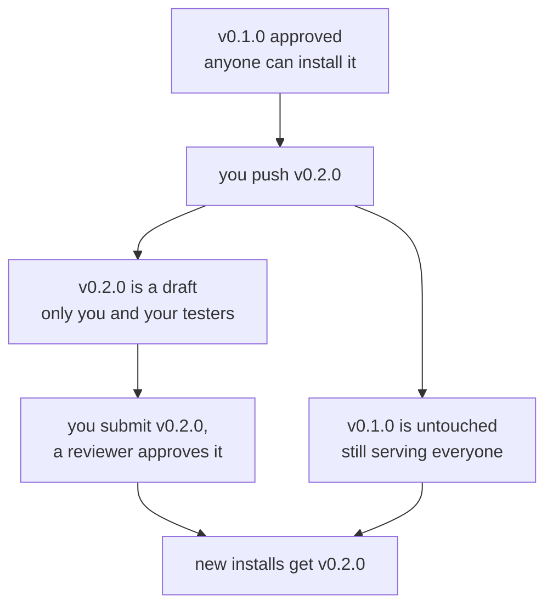

# Who can see your app, and how it becomes public

Publishing your app no longer makes it public. From the moment it publishes it
is **private to you**: you can install it, test it and use it in Pippa exactly
as a stranger would, and nobody else can see that it exists. It becomes public
when a reviewer approves it, and not before.

That is a change in what "live" means, and it is worth two minutes of reading,
because almost everything confusing about it comes from expecting the old
behaviour.

## Why it works this way

Anyone can push an app into a real assistant used by real people. Until now
the only thing between a student's first commit and everybody's Pippa was a
manifest check. Review puts a person in that gap.

The cost is one button at the end. The thing it buys is that you can push
twenty times in an afternoon, try each one properly inside Pippa, show it to a
friend, and still decide not to inflict it on anyone.

## The five states

Every version of your app is in exactly one of them.

| State | Who can see and run it | How it gets there |
|---|---|---|
| **draft** | you, your testers, the reviewers | every push lands here |
| **pending** | the same people — submitting changes nothing for users | you press Submit for review |
| **approved** | everybody | a reviewer says yes |
| **rejected** | you, your testers, the reviewers | a reviewer says no, and writes why |
| **suspended** | nobody, including you | a reviewer pulls an approved app |



Two things that catch people out:

- **The state belongs to a version, not to your app.** `0.1.0` can be approved
  and public while `0.2.0` sits in draft, private to you. That is what makes
  updating safe — see [Changing an app that is already
  approved](#changing-an-app-that-is-already-approved).
- **Submitting changes nothing a user would notice.** Pending is as private as
  draft. Submitting is a message to the reviewers, not a change to the app.

## Testing it while it is private

Exactly as you would test a public app, which is the point.

1. Open **[app.getpippa.ai/apps](https://app.getpippa.ai/apps)** signed in as
   the account in your manifest's `owner_email`.
2. Find your app and **install** it. It is there because you own it; it is not
   there for anyone else.
3. Ask Pippa one of your example phrases in the chat.

It runs the same way it will on the day it is public: same sandbox, same
twenty seconds, same manifest enforcement, same routing. Nothing about a
private app is a simulation, so a private app that works is an app that works.

### `owner_email` is the whole of "you own it"

Nothing else in the system connects an app to a person. The push comes from a
repository, and a repository is not an account — so `owner_email` in
`manifest.yaml` is the only thing that says the app is yours:

```yaml
owner_email: sam@mycollege.ac.uk
```

Put the address you **sign in to Pippa with** there — the one your invitation
was sent to. If it is missing, misspelt, or another address you own, the app
publishes without complaint and is then invisible to everyone, you included.
There is no error to find, because nothing failed.

`scripts/check.py` warns about it, in the build log and under **Warnings** in
the commit comment, and that warning is the only sign you get:

```
 WARN owner_email is still the template's placeholder (you@example.com)
```

It is a warning rather than a failure for one reason: the app really does
publish, so refusing the push would be refusing something the platform
accepts. It is printed twice, at the top and immediately before the verdict,
because the test output in between is long enough to hide it.

`owner_email` is not `publisher`. `publisher` is the name shown to users;
Pippa does not show them `owner_email`. It is in your repository, though: in a
public repository anyone can read the address in `manifest.yaml`, and it stays
in the git history even if you change it later. Know that before you push it.

## Letting somebody else try it

Add them as a **tester**, by email, from your app's page in Pippa. A tester
can see the app, install it and use it, at whatever version is current, while
it is still private.

- Use the address they sign in to Pippa with. They need a Pippa account — a
  share is not an invitation to the platform.
- You can add them before they have ever signed in: a share is matched against
  the address, not against an account that has to exist yet.
- A share is per app, not per version: it covers whatever you push next.
- Testers cannot submit your app, cannot add other testers and cannot see any
  other app of yours. Those are yours alone.
- Removing a tester takes effect immediately. The next thing they ask Pippa
  gets answered without your app.

This is the useful half of a hackathon demo: the person next to you asking
your app something you did not think of, before a reviewer ever sees it.

## Submitting it for review

**From Pippa, not from this repository.** Open your app's page at
[app.getpippa.ai/apps](https://app.getpippa.ai/apps) and press **Submit for
review**.

### There is no `scripts/submit.py`, and there should not be

It was considered and it cannot be built, for three separate reasons, any one
of which is enough:

1. **The repository has no credential that could submit.** Review lives behind
   a service-to-service key held by Pippa's own services, and your repository
   does not have one. What the build has is a short-lived identity token it
   exchanges for permission to publish this one app and nothing else —
   deliberately, because that is the credential every hackathon repository
   holds.
2. **Submitting has to be done by a person, signed in.** The service decides
   who is submitting from a verified Pippa login, and it refuses a submission
   for an app the caller does not own. A script running in CI is not signed in
   as anybody.
3. **A credential that could submit would be a credential in a readable
   repository.** Your repository can be read, which is also why your app may
   not declare `secrets:` or `connectors:`. Submission is not worth making an
   exception for.

The build could in principle submit on your behalf with every push, and that
would be worse than having no script at all: a push is "here is my latest
attempt", and submitting is "this one is ready". They are not the same
sentence, and a reviewer's queue full of the first kind helps nobody.

So: push to publish, click to submit. Two actions, because they mean two
different things.

### What a reviewer sees

Everything in your manifest: the app's name, summary and publisher, every
outcome with its example phrases, every input and output, the owner's email
address, and who you have shared it with. They do not read your code.

Which makes the manifest worth a last read before you submit, this time as
prose. "Tidal predictions service" tells a reviewer nothing, the same way it
tells the routing model nothing.

### After you submit

Nothing in this repository can tell you the verdict. It appears against your
app on the Apps page in Pippa — approved, or rejected with a reason you can
read.

You can keep pushing while you wait. A push to a version that is already
submitted updates the code and **leaves it submitted**, so fixing a typo
after you press the button does not quietly withdraw you from the queue.

## If it is rejected

A rejection comes with a reason, written for you, and shown with the app. It
is a request for changes rather than a verdict on you: a rejected app is
private, exactly like a draft, and you fix it and submit again.

Nothing stops you pushing the same version number — a version that is not
approved can be replaced in place as often as you like, which is what makes
the push-try-fix loop fast. Fix the thing the reason names, push, press
Submit for review again.

## Changing an app that is already approved

Once a version is approved, other people have it, and **that version is
frozen**. Pushing it again is refused:

```
Pippa refused to publish this app:

  hack.tide_times 0.1.0 has already been approved and is in use. Bump the
  version in manifest.yaml and push again — the new version is yours to test
  privately, and the approved one keeps working for everyone until you submit
  it and it is approved in turn.
```

The fix is one line in `manifest.yaml`:

```yaml
app:
  version: 0.2.0     # was 0.1.0
```

The refusal is not bureaucracy. If an approved version could be replaced in
place, the thing a reviewer approved and the thing people are running would be
different things, and approval would mean nothing.



So an update costs nobody anything. Your approved app keeps answering
questions for everyone who has it while you break the new one as much as you
like.

One detail worth knowing: an install remembers the version it was made with.
Somebody who installed `0.1.0` goes on running `0.1.0` until they install your
app again, which is why your own test of a change needs a fresh install rather
than the one you did an hour ago.

## Suspension

A reviewer can pull an app that was approved. A suspended app disappears for
everybody — it is not listed, it cannot be installed, and it stops running for
people who had already installed it, including you.

That last part is the difference between suspension and every other private
state. The reason to suspend something is that it should stop, and "stops for
everyone except its author" is not stopping.

You will see the app and the reason on your own Apps page. Resubmitting is not
the way out of a suspension: it is a conversation with an organiser.

## If your app is public the moment it publishes

Then review has been switched off for this event, which is one setting on the
runtime (`PIPPA_APPRUNTIME_ENFORCE_REVIEW`) and not something wrong with your
app. Everything in this page still describes how it will behave when it is on;
nothing you write needs to change.

## Things that have not changed

- Pushing to `main` is still the deploy, and still the only one.
- The build still checks the manifest, runs your tests and refuses the same
  things it always did. See `docs/TROUBLESHOOTING.md`.
- Routing is unchanged. A private app competes for a question exactly as a
  public one does — against every other app *you* have installed.
- Your app still learns nothing about who is calling it. Who may run it is
  decided before your code is reached; `handle()` is handed inputs, as always.

## The short version

1. Push. The app publishes, privately.
2. Install it yourself and try it in Pippa.
3. Add a tester or two by email, and let them break it.
4. Press **Submit for review** in Pippa when it is ready.
5. Approved, and everybody can install it. Rejected, and you get a reason,
   fix it, and submit again.
6. Changing an approved app: bump `app.version`, push, submit the new version.
   The old one keeps working throughout.
